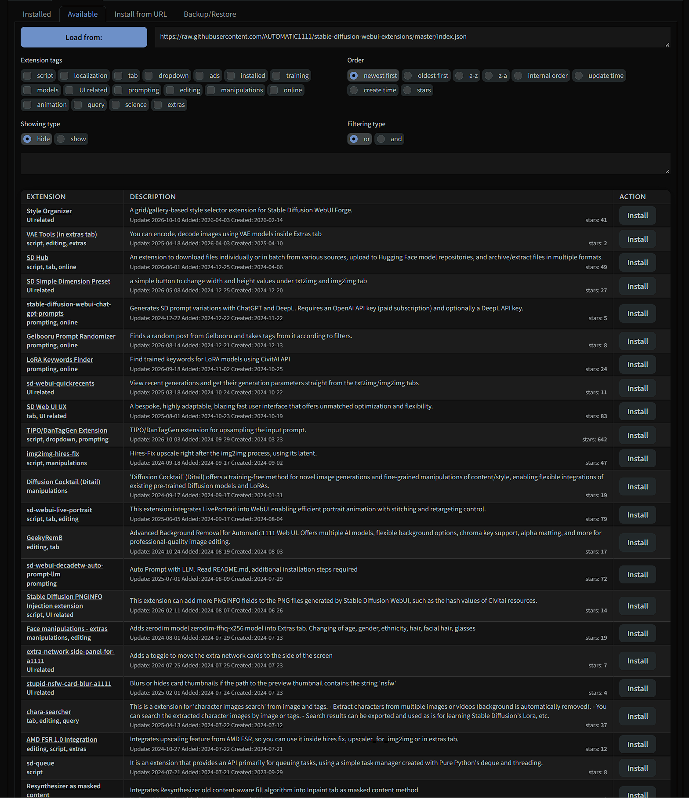
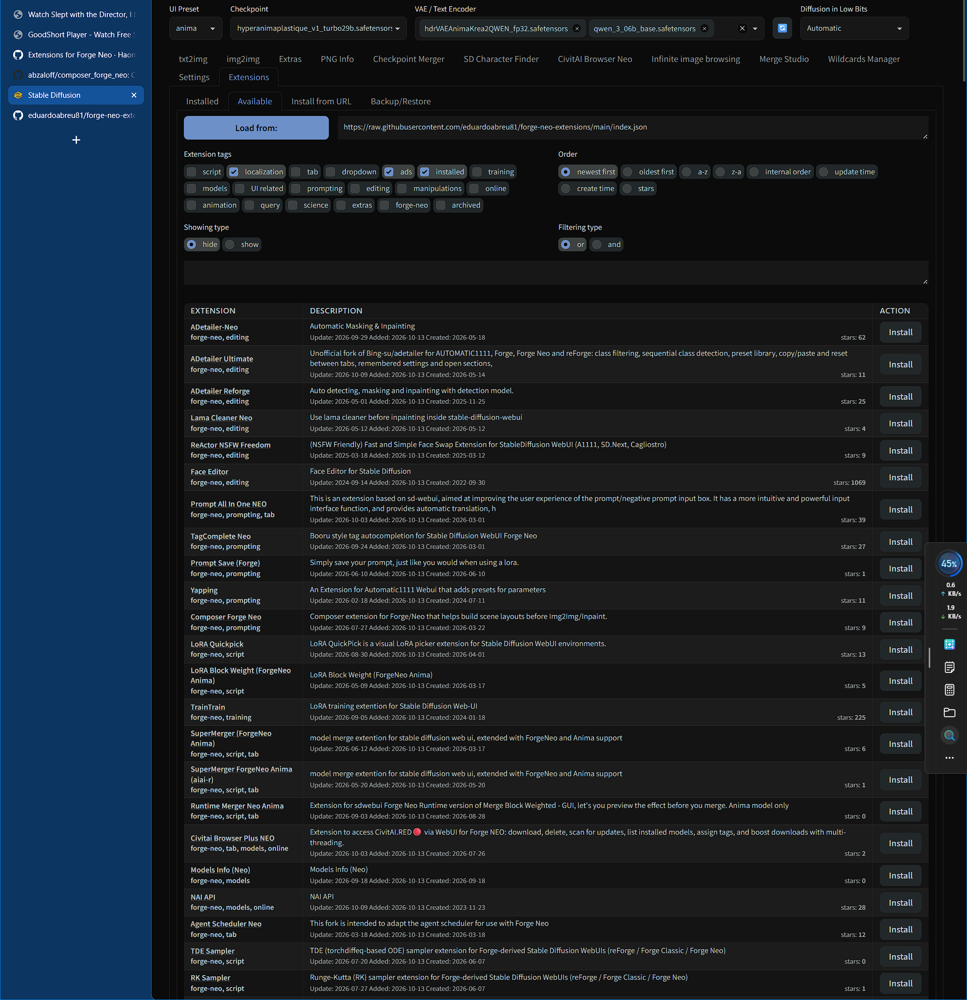

# 🟢 Forge Neo Extensions Index

<div align="center">

[](https://github.com/Haoming02/sd-webui-forge-classic/tree/neo)
[](index.json)
[](index.json)

> **An extension index for [Stable Diffusion WebUI Forge - Neo](https://github.com/Haoming02/sd-webui-forge-classic/tree/neo)**

</div>

The **Extensions → Available** tab in Forge Neo loads AUTOMATIC1111's classic index by default, so almost nothing of the Forge Neo ecosystem shows up there. This repository hosts a drop-in replacement: the classic index with everything dead removed, **plus the Forge Neo ecosystem** — every Neo extension marked with a 🟢 in the name and a `forge-neo` tag you can filter.

| Classic index | This index |
| :---: | :---: |
|  |  |

## Use

In **Extensions → Available**, paste this URL into *Extension index URL* and click **Load from**:

```text
https://raw.githubusercontent.com/eduardoabreu81/forge-neo-extensions/main/index.json
```

To list only the Neo ecosystem, tick the `forge-neo` tag and switch **Showing type** to *show*.

## Updates

Regenerated and re-validated **monthly** with `build_index_neo.py`: repositories that no longer exist (dead or archived) are removed, and new Forge Neo extensions from the [community thread](https://github.com/Haoming02/sd-webui-forge-classic/discussions/1128) are added.

---

<div align="center">

Made with ❤️ for the Stable Diffusion community

**[Report Bug](https://github.com/eduardoabreu81/forge-neo-extensions/issues)** • **[Request Feature](https://github.com/eduardoabreu81/forge-neo-extensions/issues)** • **[☕ Ko-fi](https://ko-fi.com/eduardoabreu81)**

</div>
