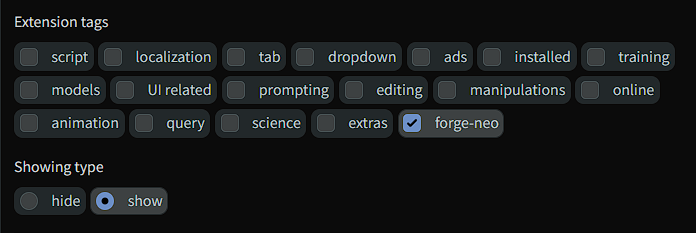

# 🟢 Forge Neo Extensions Index

<div align="center">

[](https://github.com/Haoming02/sd-webui-forge-classic/tree/neo)
[](index.json)
[](index.json)

> **An extension index for [Stable Diffusion WebUI Forge - Neo](https://github.com/Haoming02/sd-webui-forge-classic/tree/neo)**

</div>

The **Extensions → Available** tab in Forge Neo loads AUTOMATIC1111's classic index by default, so almost nothing of the Forge Neo ecosystem shows up there. This repository hosts a drop-in replacement: the classic index with everything dead removed, **plus the Forge Neo ecosystem** — every Neo extension marked with a 🟢 in the name and a `forge-neo` tag you can filter.

| Classic index | This index |
| :---: | :---: |
|  |  |

## Use

In **Extensions → Available**, paste this URL into *Extension index URL* and click **Load from**:

```text
https://raw.githubusercontent.com/eduardoabreu81/forge-neo-extensions/main/index.json
```

To list only the Neo ecosystem, tick the `forge-neo` tag and switch **Showing type** to *show*:



### Make it the default

Forge Neo reads the index URL from the `WEBUI_EXTENSIONS_INDEX` environment variable. Add this line to `webui-user.bat`, before `call webui.bat`, and the Available tab loads this list by default, even after Forge updates:

```bat
set WEBUI_EXTENSIONS_INDEX=https://raw.githubusercontent.com/eduardoabreu81/forge-neo-extensions/main/index.json
```

On Linux or macOS, use `export WEBUI_EXTENSIONS_INDEX=...` in `webui-user.sh`.

## The Forge Neo list

### Inpaint, face & detection

| Extension | Author |
| --- | --- |
| [ADetailer-Neo](https://github.com/Haoming02/ADetailer-Neo) | Haoming02 |
| [ADetailer NeoForge](https://github.com/abzaloff/aadetailer-neoforge) | abzaloff |
| [ADetailer Ultimate](https://github.com/xXIlRizzoXx/adetailer-ultimate) | xXIlRizzoXx |
| [ADetailer Reforge](https://github.com/Anzhc/aadetailer-reforge) | Anzhc |
| [Lama Cleaner Neo](https://github.com/abzaloff/forge-neo-lama-cleaner) | abzaloff |
| [ReActor NSFW Freedom](https://github.com/kainatquaderee/sd-webui-reactor-Nsfw_freedom) | kainatquaderee |
| [Face Editor](https://github.com/ototadana/sd-face-editor) | ototadana (original, runs on Neo) |
| [Visage](https://github.com/eduardoabreu81/visage-forge-neo) | eduardoabreu81 |
| [Impact ADetailer Neo](https://github.com/sca-285/sd-Impact-ADetailer-Neo) | sca-285 |
| [ReActor (abzaloff)](https://github.com/abzaloff/sd-webui-reactor) | abzaloff |

### Prompting

| Extension | Author |
| --- | --- |
| [Prompt All In One NEO](https://github.com/eduardoabreu81/sd-webui-prompt-all-in-one-neo) | eduardoabreu81 |
| [TagComplete Neo](https://github.com/eduardoabreu81/sd-webui-tagcomplete-neo) | eduardoabreu81 |
| [Prompt Studio Neo](https://github.com/eduardoabreu81/sd-webui-prompt-studio-neo) | eduardoabreu81 |
| [Dynamic Prompts Neo](https://github.com/abzaloff/sd-dynamic-prompts) | abzaloff |
| [Prompt Save (Forge)](https://github.com/zeydsama/sd-forge-prompt-save) | zeydsama |
| [Yapping](https://github.com/Haoming02/sd-webui-yapping) | Haoming02 |
| [Prompt Vault](https://github.com/sca-285/sd-webui-prompt-vault) | sca-285 |

### Wildcards & composers

| Extension | Author |
| --- | --- |
| [Wildcard Composer Neo](https://github.com/eduardoabreu81/sd-wildcard-composer-neo) | eduardoabreu81 |
| [Composer Forge Neo](https://github.com/abzaloff/composer_forge_neo) | abzaloff |

### LoRA

| Extension | Author |
| --- | --- |
| [LoRA Quickpick](https://github.com/abzaloff/sd-webui-lora-quickpick) | abzaloff |
| [LoRA Block Weight (ForgeNeo Anima)](https://github.com/kiygskr/sd-webui-lora-block-weight-forgeneo-anima) | kiygskr |
| [TrainTrain](https://github.com/hako-mikan/sd-webui-traintrain) | hako-mikan |
| [LoRA Mixer](https://github.com/sca-285/sd-forge-neo-LORA-mixer) | sca-285 |

### Checkpoint merging

| Extension | Author |
| --- | --- |
| [Merge Studio](https://github.com/eduardoabreu81/sd-webui-merge-studio) | eduardoabreu81 |
| [SuperMerger (ForgeNeo Anima)](https://github.com/kiygskr/sd-webui-supermerger-forgeneo-anima) | kiygskr |
| [SuperMerger ForgeNeo Anima, aiai-r fork](https://github.com/aiai-r/sd-webui-supermerger-forgeneo-anima) | aiai-r |
| [Runtime Merger Neo Anima](https://github.com/darkninjavn/sd-webui-runtime-merger-neo-Anima) | darkninjavn |

### Civitai & model management

| Extension | Author |
| --- | --- |
| [Civitai Browser Neo](https://github.com/eduardoabreu81/sd-civitai-browser-neo) | eduardoabreu81 |
| [Civitai Browser Plus NEO](https://github.com/masterofobzene/sd-civitai-browser-plus-NEO) | masterofobzene |
| [Models Info (Neo)](https://github.com/Squibeel/models-info) | Squibeel |
| [NAI API](https://github.com/Metachs/sdwebui-nai-api) | Metachs |
| [xCloneCleaner](https://github.com/sdprompts/xCloneCleaner) | sdprompts |

### Samplers & schedulers

| Extension | Author |
| --- | --- |
| [Agent Scheduler Neo](https://github.com/cataclisma/sd-webui-agent-scheduler-neo) | cataclisma |
| [TDE Sampler](https://github.com/seti9585/sd-webui-tde-sampler) | seti9585 |
| [RK Sampler](https://github.com/seti9585/sd-webui-rk-sampler) | seti9585 |
| [RES4LYF (Forge)](https://github.com/zeydsama/sd-forge-res4lyf) | zeydsama |
| [Beta57](https://github.com/zeydsama/sd-forge-beta57) | zeydsama |
| [DLSS5](https://github.com/zeydsama/sd-forge-dlss5) | zeydsama |
| [Extra Schedulers (Neo)](https://github.com/aoleg/Neo_ExtraSchedulers) | aoleg |
| [SPEED](https://github.com/aoleg/ComfyUI-SPEED) | aoleg |
| [Kitchen Samplers](https://github.com/sca-285/sd-kitchen-samplers) | sca-285 |

### Regional, conditioning & effects

| Extension | Author |
| --- | --- |
| [Attention Couple](https://github.com/Haoming02/sd-forge-couple) | Haoming02 |
| [IC-Light](https://github.com/Haoming02/sd-forge-ic-light) | Haoming02 |
| [NegPiP (Krea 2)](https://github.com/aoleg/neo-krea2-negpip) | aoleg |
| [Krea 2 Conditioning Control](https://github.com/aoleg/neo-krea2-conditioning) | aoleg |
| [Krea2 NAG](https://github.com/aoleg/Neo-Krea2-NAG) | aoleg |
| [Krea 2 Edit V2](https://github.com/eduardoabreu81/krea2-edit-forge-neo) | eduardoabreu81 |
| [Regional Boxes](https://github.com/eduardoabreu81/sd-regional-boxes-neo) | eduardoabreu81 |
| [NegPiP (Krea 2 / MOSS-Image)](https://github.com/flyfront/sd-forge-negpip) | flyfront |
| [Steer CFG Attention Guidance](https://github.com/sca-285/sd-steer-cfg-attention-guidance) | sca-285 |
| [Anima Reference](https://github.com/eduardoabreu81/anima-reference-forge-neo) | eduardoabreu81 |

### Upscale, restoration & finishing

| Extension | Author |
| --- | --- |
| [SeedVR2 (Neo)](https://github.com/aoleg/seedvr2-webui-neo-extension) | aoleg |
| [Auto Color Corrector](https://github.com/sca-285/sd-forge-auto-color-corrector) | sca-285 |
| [Optical Realism](https://github.com/sca-285/sd-forge-optical-realism) | sca-285 |
| [Digital Mastering](https://github.com/sca-285/sd-webui-digital-mastering) | sca-285 |

### UI & workflow

| Extension | Author |
| --- | --- |
| [State Manager Neo](https://github.com/eduardoabreu81/sd-webui-state-manager-neo) | eduardoabreu81 |
| [Split Extra Networks](https://github.com/BulbulLeung/forge-split-extra-networks) | BulbulLeung |
| [Generation Layout](https://github.com/BulbulLeung/sd-generation-layout) | BulbulLeung |
| [Folder Switcher](https://github.com/diamfang/sd-webui-folder-switcher) | diamfang |
| [Smooth Progress](https://github.com/diamfang/sd-webui-smooth-progress) | diamfang |
| [Preset Manager Neo](https://github.com/masterofobzene/preset-manager-neo) | masterofobzene |
| [TIPO PNGInfo Restore](https://github.com/seti9585/sd-webui-TIPO-PNGInfo-Restore) | seti9585 |
| [Repeat Generate 4NEO](https://github.com/hirorohi03/repeat-generate-4NEO) | hirorohi03 |
| [WD 1.4 Tagger (Neo)](https://github.com/hirorohi03/stable-diffusion-webui-wd14-tagger) | hirorohi03 |
| [Photopea Embed (ReForge / Neo)](https://github.com/sca-285/sd-webui-photopea-embed-ReForge-Neo) | sca-285 |
| [Lobe Theme Redux](https://github.com/sca-285/sd-webui-lobe-theme-redux) | sca-285 |
| [Forge Notebook](https://github.com/sca-285/sd-forge-notebook) | sca-285 |
| [Florence-2 (Neo)](https://github.com/AMGarkin/sd-webui-florence-2-neo) | AMGarkin |

### Model engines (models not native to Forge Neo yet)

| Extension | Author |
| --- | --- |
| [Iris-3B for Forge Neo](https://github.com/eduardoabreu81/iris-3b-forge-neo) | eduardoabreu81 |
| [MiniMax H3 for Forge Neo](https://github.com/eduardoabreu81/minimax-h3-forge-neo) | eduardoabreu81 |
| [Qwen-Image 2.1 for Forge Neo](https://github.com/eduardoabreu81/qwen2.1-forge-neo) | eduardoabreu81 |
| [MOSS-Image for Forge Neo](https://github.com/eduardoabreu81/moss-image-forge-neo) | eduardoabreu81 |
| [FIBO 2 for Forge Neo](https://github.com/eduardoabreu81/fibo2-forge-neo) | eduardoabreu81 |

### Also tagged 🟢 (already in the classic index)

[LoRA Block Weight](https://github.com/hako-mikan/sd-webui-lora-block-weight), [NegPiP](https://github.com/hako-mikan/sd-webui-negpip), [Regional Prompter](https://github.com/hako-mikan/sd-webui-regional-prompter), [SuperMerger](https://github.com/hako-mikan/sd-webui-supermerger), [LoRA Control](https://github.com/cheald/sd-webui-loractl), [Detail Daemon](https://github.com/muerrilla/sd-webui-detail-daemon), [SD Hub](https://github.com/gutris1/sd-hub), [CivBrowser](https://github.com/SignalFlagZ/sd-webui-civbrowser), [Prompt Format](https://github.com/Haoming02/sd-webui-prompt-format), [Vectorscope CC](https://github.com/Haoming02/sd-webui-vectorscope-cc), [img2img-hires-fix](https://github.com/Amadeus-AI/img2img-hires-fix), [PNGINFO Beautify](https://github.com/bluelovers/sd-webui-pnginfo-beautify) and [Test my prompt!](https://github.com/Extraltodeus/test_my_prompt)

## Updates

The index is **updated monthly**, following the [community thread](https://github.com/Haoming02/sd-webui-forge-classic/discussions/1128).

---

<div align="center">

Made with ❤️ for the Stable Diffusion community

**[Report Bug](https://github.com/eduardoabreu81/forge-neo-extensions/issues)** • **[Request Feature](https://github.com/eduardoabreu81/forge-neo-extensions/issues)** • **[☕ Ko-fi](https://ko-fi.com/eduardoabreu81)**

</div>
