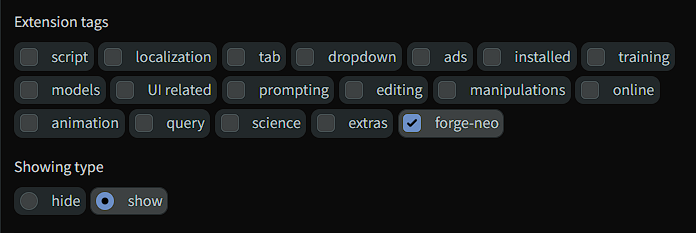

# 🟢 Forge Neo Extensions Index

<div align="center">

[](https://github.com/Haoming02/sd-webui-forge-classic/tree/neo)
[](https://github.com/Haoming02/sd-webui-forge-classic/commit/e67193d9)
[](index.json)
[](index.json)

> **The default extension index of [Stable Diffusion WebUI Forge - Neo](https://github.com/Haoming02/sd-webui-forge-classic/tree/neo)**

</div>

Since **15 November 2026** ([`e67193d9`](https://github.com/Haoming02/sd-webui-forge-classic/commit/e67193d9), *rewrite Extensions tab*), the **Extensions → Available** tab in Forge Neo loads this index out of the box. It is AUTOMATIC1111's classic index with everything dead removed, **plus the Forge Neo ecosystem**: every Neo extension marked with a 🟢 in the name and a `forge-neo` tag you can filter.

| Classic index | This index |
| :---: | :---: |
|  |  |

## Use

Update Forge Neo, open **Extensions → Available** and click **Load from Index**. Nothing to configure.

To list only the Neo ecosystem, tick the `forge-neo` tag and switch **Filter Type** to *show*. The **2025+** box is ticked by default, so untick it to see older extensions too:



> [!NOTE]
> Extensions in this index are made by third parties. Check an extension's repository before you install it, as the note in the Available tab says.

### Older builds, or a different index

On a Forge Neo build from before 15 November 2026, paste this URL into the index field of **Extensions → Available** and click **Load from**:

```text
https://raw.githubusercontent.com/eduardoabreu81/forge-neo-extensions/main/index.json
```

Forge Neo still reads the `WEBUI_EXTENSIONS_INDEX` environment variable first, so a value set there overrides this default. If you set it earlier to point at this index, it keeps working and can stay or go. To use another index instead, set it in `webui-user.bat`, before `call webui.bat`:

```bat
set WEBUI_EXTENSIONS_INDEX=https://example.com/your-index.json
```

On Linux or macOS, use `export WEBUI_EXTENSIONS_INDEX=...` in `webui-user.sh`.

## Add an extension

Made an extension that runs on Forge Neo, or found one missing? [Open an issue](https://github.com/eduardoabreu81/forge-neo-extensions/issues) with the repository link.

## The Forge Neo list

All 121 Forge Neo extensions, with what each one does, are on the **[wiki](https://github.com/eduardoabreu81/forge-neo-extensions/wiki)**, sorted by topic:

| Topic | Extensions |
| --- | :---: |
| 🛠️ [Workflow & Interface](https://github.com/eduardoabreu81/forge-neo-extensions/wiki/Workflow-and-Interface) | 24 |
| ✍️ [Prompting](https://github.com/eduardoabreu81/forge-neo-extensions/wiki/Prompting) | 22 |
| 🎲 [Sampling & Guidance](https://github.com/eduardoabreu81/forge-neo-extensions/wiki/Sampling-and-Guidance) | 16 |
| 📦 [Models: Merge, Convert & Download](https://github.com/eduardoabreu81/forge-neo-extensions/wiki/Models-Merge-Convert-and-Download) | 12 |
| 🚀 [Model Engines](https://github.com/eduardoabreu81/forge-neo-extensions/wiki/Model-Engines) | 11 |
| 🎭 [Detailing, Inpainting & Faces](https://github.com/eduardoabreu81/forge-neo-extensions/wiki/Detailing-Inpainting-and-Faces) | 11 |
| ✨ [Upscale, Color & Finishing](https://github.com/eduardoabreu81/forge-neo-extensions/wiki/Upscale-Color-and-Finishing) | 10 |
| 🖼️ [Composition, Reference & Editing](https://github.com/eduardoabreu81/forge-neo-extensions/wiki/Composition-Reference-and-Editing) | 9 |
| 🧩 [LoRA & Training](https://github.com/eduardoabreu81/forge-neo-extensions/wiki/LoRA-and-Training) | 6 |

The people who make them are on the [👥 Creators](https://github.com/eduardoabreu81/forge-neo-extensions/wiki/Creators) page.

## Updates

The index is **updated monthly**, following the [community thread](https://github.com/Haoming02/sd-webui-forge-classic/discussions/1128).

---

<div align="center">

Made with ❤️ for the Stable Diffusion community

**[Report Bug](https://github.com/eduardoabreu81/forge-neo-extensions/issues)** • **[Request Feature](https://github.com/eduardoabreu81/forge-neo-extensions/issues)** • **[☕ Ko-fi](https://ko-fi.com/eduardoabreu81)**

</div>
